 

  

| 📦 16 | 🧑‍💻 7 | 🧭 5 |
| :---: | :---: | :---: |
| projects built | languages used | areas: security · AI bots · learning · business · Mac tools |

## 🛡️ Safety, security & protection

Protection that is checked, can be rolled back and watches itself.

| 🌐 2.4 M | 🚫 ~305,000 | 🔁 3 |
| :---: | :---: | :---: |
| domains blocked by the DNS filter | tracker domains on the blocklist | scripts that belong together: apply · audit · roll back |

| Project | What it does |
| --- | --- |
| 🔐 **Mac Hardening Suite** | Three scripts that belong together: one applies the hardening step by step, one audits every point read-only (OK or missing), one rolls changes back |
| 🧱 **DNS Filter** | A local, encrypted DNS filter for 2.4 million blocked domains — ads, trackers and malware — with its own guard |
| 👁️ **Schutzwache** | A watchdog for security services: notices when one stops, restarts it and reports |
| 🚫 **Tracker Blocklist** | Builds the largest tracker, ad and malware blocklist the system can handle, in selectable levels |
| 📶 **Netz-Check** | Measures the protection and speed of an internet connection and writes an HTML report |
| 🤖 **AI safety in Paul** | The AI teammate cannot run code, and may only use chat commands from an allow list — destructive ones are blocked |

**Principles:** least privilege · rollback paths · audit before and after · no secrets in repositories

## 🚀 Flagship: Paul — the Minecraft AI buddy

An AI teammate that joins your own world, talks out loud, walks with you and remembers every world separately.

| ⚡ 1.9–3.8 s | 🗺️ 76 | 🎮 3 | 🧪 0 kicks | 🧩 5 |
| :---: | :---: | :---: | :---: | :---: |
| per answer, down from 13 s | world guides | Minecraft versions (1.21 · 1.21.11 · 26.3) | in the final end-to-end test | languages in one codebase |

- 🗣️ **Voice and personality** — speaks with a system voice, two switchable characters
- 🧠 **Memory per world** — never mixes up places between worlds
- 🤖 **Own robot skin** — generated by script, shipped as a resource pack
- 🔧 **Deep fixes, not workarounds** — found the cause of a movement kick with a custom server probe; repaired a broken mod by patching its bytecode
- 🔒 **Safe by default** — code execution off, chat commands only from an allow list

## 🎓 Learning tools

| Project | What it does |
| --- | --- |
| 📚 **E1-Prüfungstrainer** | A complete local learning system for a school entrance exam in German, English and maths — no account, no server, all data stays in the browser |
| 🧪 **Exam Trainer (Maths & Science)** | Practice system in English for an international school entrance test, built with TypeScript and Vite, with its own test suite |
| ➗ **Mathe-Trainer** | A single-file maths trainer that runs in any browser, fully offline |

## 📈 Business & automation

| Project | What it does |
| --- | --- |
| 🏭 **Auftragsmaschine 2.0** | Local system for solo freelancers: finds local businesses, audits their websites for provable flaws, and produces the analysis document, call guide and print-ready letter — plus the pipeline maths behind a revenue goal |
| 📡 **Verschenk-Radar** | Watches free-item listings, flags things worth picking up and prepares message drafts — a human always sends them |

## 🍏 Mac tools

| Project | What it does |
| --- | --- |
| 🔇 **Vorssaint-Stumm** | A small Swift tool on CoreAudio that truly mutes the speakers when the volume reaches zero — fixes a gap where they kept playing at −63.5 dB |
| 🗂️ **Screenshot Sorter** | Sorts screenshots into topic folders by year and month and keeps a searchable catalogue |

## ⛏️ More Minecraft engineering

| Project | What it does |
| --- | --- |
| 🏰 **Minecraft Festung** | Fortresses built by datapack: a 41×41 TNT-proof base with a lock, and a mountain castle on a 192×192 platform — every part checked block by block |
| ✨ **Enchant-Bot** | A Mineflayer bot that joins as its own player and enchants your gear on request in chat |
| 🎒 **Gearkit** | A generator for a datapack that hands out 29 shulker boxes of fully enchanted gear, for two game-version ranges |
| 🗺️ **Unstable Maps Lab** | Tooling to analyse and test Minecraft maps across game versions, with its own test server and client |

Most repositories are private while they are in development.

## 🧭 How I work

- ✅ **Tested, not just demoed** — a real game client runs the full path on every change
- 🛡️ **Safe by default** — risky features stay off until I switch them on
- 📝 **Written down** — causes of bugs, decisions and open points are documented
- 🤝 **Honest credit** — built on [Mindcraft](https://github.com/mindcraft-bots/mindcraft), [Mineflayer](https://github.com/PrismarineJS/mineflayer) and [ViaProxy](https://github.com/ViaVersion/ViaProxy)

## 🔭 Right now

- Faster answers for Paul
- More world guides and smarter reactions
- Support for the newest Minecraft versions

